<a href="https://pratyushshivam.github.io/event-horizon/">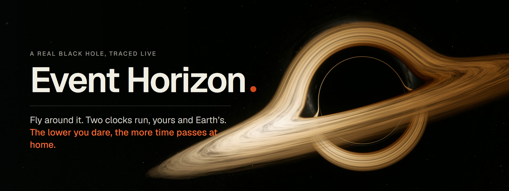</a>

<p align="center">
  <a href="https://pratyushshivam.github.io/event-horizon/"></a>
  <a href="https://github.com/pratyushshivam/event-horizon/actions/workflows/ci.yml"></a>
  <a href="LICENSE"></a>
  
</p>

<p align="center">
  <a href="https://pratyushshivam.github.io/event-horizon/"><b>Fly it</b></a> ·
  <a href="#how-to-fly">How to fly</a> ·
  <a href="#photographs">Photographs</a> ·
  <a href="#the-physics">The physics</a> ·
  <a href="#checked-against-nasa-and-the-event-horizon-telescope">Checked against NASA</a> ·
  <a href="#run-it">Run it</a> ·
  <a href="https://www.pratyushshivam.com/">pratyushshivam.com</a>
</p>

# Event Horizon

**Fly a ship around a real black hole. Your clock and Earth's clock start together. They do not stay together.**

The picture is not a painting or a video. For every pixel, every frame, a ray of light is followed backwards through curved spacetime on your graphics card, so what you see is what a camera there would see: the black shadow, the thin ring of light around it, the far side of the disk bent up over the top.

The page opens on the view alone. Drag to look around it, scroll to move closer, and listen: the nearer you go, the colder it sounds, and inside the horizon there is no light and no sound at all. Then press **Play the game**.

In the game you start in orbit at a station. Brake and you fall towards the hole. The lower and faster you fly, the slower your clock runs against Earth's. Climb back out and the end card tells you how long you were gone, what date it now is at home, and what you missed. Go too low and you find out what the horizon is.

**Fly:** [pratyushshivam.github.io/event-horizon](https://pratyushshivam.github.io/event-horizon/)

<a href="https://pratyushshivam.github.io/event-horizon/">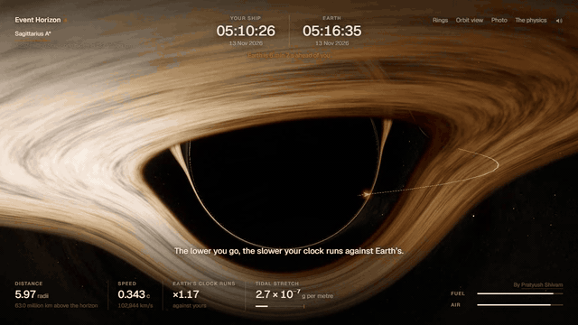</a>

<p align="center"><sub>Eight seconds of one pass at about four radii from Sagittarius A*, recorded from the running page at real speed. Watch the two clocks at the top.</sub></p>

There is nothing to read first. The page opens on the black hole with one line of words, drag to look around, and one button. The game adds one more line and a ghost finger showing the one control. There is no account, no server and no tracking. The code is about 30 kB; the sky it flies under is real and weighs 1.7 MB.

<table>
<tr>
<td width="50%" valign="top">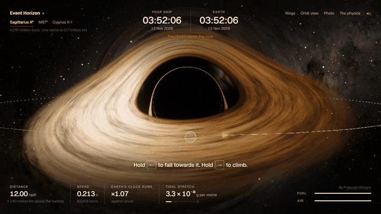<br><sub><b>The first seconds.</b> Look around first. Play the game, and the camera glides down to the ship.</sub></td>
<td width="50%" valign="top">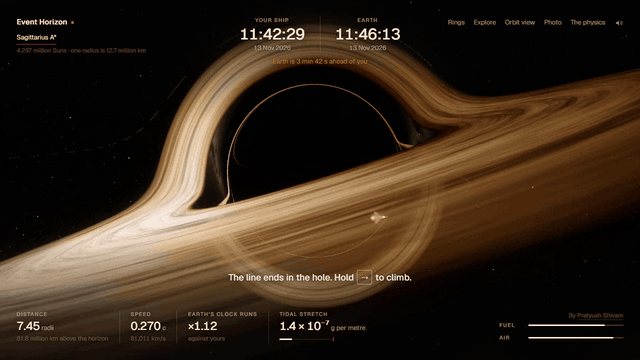<br><sub><b>Too low.</b> The view cuts to what the station sees: your ship slowing, reddening and fading at the horizon, never crossing.</sub></td>
</tr>
<tr>
<td width="50%" valign="top">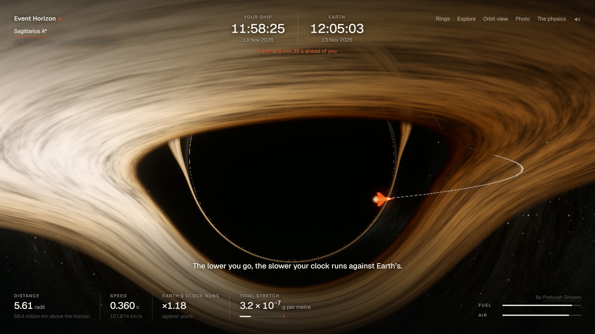<br><sub><b>The instruments.</b> Distance, speed, the rate of Earth's clock against yours, tidal stretch, fuel and air. Nothing else.</sub></td>
<td width="50%" valign="top">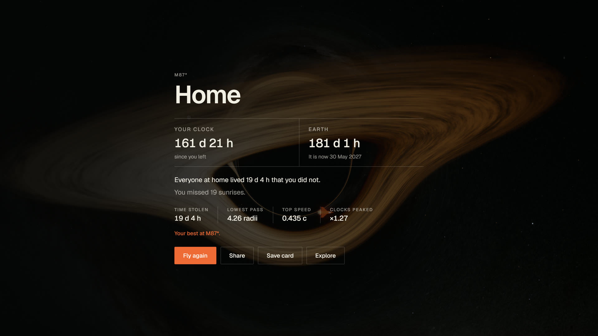<br><sub><b>Home.</b> Around M87* a one-minute run is half a year. The card says what day it is now, and what went by without you.</sub></td>
</tr>
<tr>
<td width="50%" valign="top">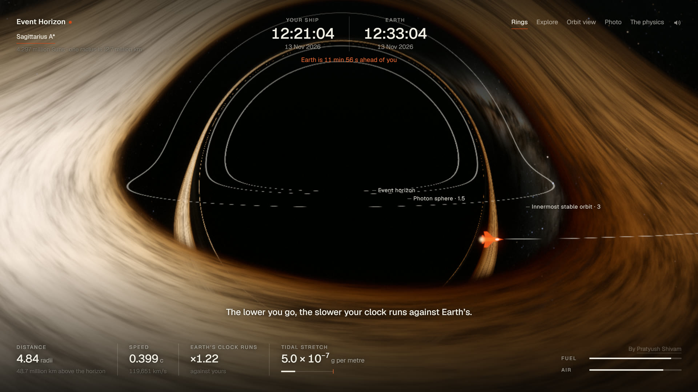<br><sub><b>Rings on demand.</b> Horizon, photon sphere, innermost stable orbit. They are traced through the same bent light, so the parts behind the hole arch up over it.</sub></td>
<td width="50%" valign="top">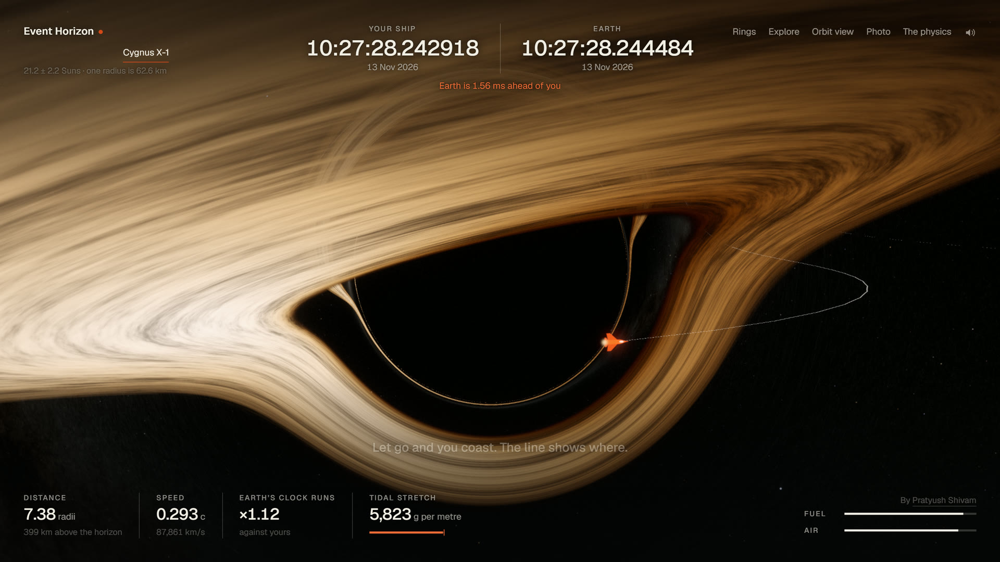<br><sub><b>The small one is the deadly one.</b> Cygnus X-1 is 21 Suns. Its clocks tick in millionths of a second, and its tides pull the ship apart at 6 radii.</sub></td>
</tr>
</table>

## How to fly

| | |
| :-- | :-- |
| **Explore** | Where the page opens. Drag to look around, scroll or pinch to move in and out, as far as the inside of the horizon, where everything goes black and silent. **Play the game** starts a run; **Explore** in the top bar brings you back |
| **Fall** | Hold `←` (or drag left and hold). The engine brakes, and the orbit drops towards the hole |
| **Climb** | Hold `→` (or drag right). The engine pushes you along your orbit, and the far side of it rises |
| **In and out** | `↑` pushes straight at the hole, `↓` straight away. You rarely need them |
| **Coast** | Let go. The thin line is where you will go. If it turns orange, it ends in the hole |
| **Come home** | Climb back out past the dashed ring at 12 radii. That ends the run safely |
| **Fuel** | 0.4 of the speed of light in total. Spend it how you like |
| **Air** | 140 seconds of play. Still out when it ends, and you are adrift |
| **The dare** | Time stolen is Earth's time minus yours. Lower and faster steals more. Best run is kept per hole |
| **Three holes** | Sagittarius A*, M87* and Cygnus X-1, each at its published mass. Same flight, very different clocks and tides |
| **Rings** `R` | Names the horizon, the photon sphere and the innermost stable orbit |
| **Orbit view** `V` | Step back and drag to look around. Keys still fly the ship |
| **Photo** `P` | Hides everything, frees the camera, saves a 4K still |
| **Sound** `M` | Made in the page, no recordings. A low bed that sinks as you go in; closer, a cluster of voices a semitone apart and a howl of filtered noise, with a pulse that quickens. In the game, two ticks, your second and Earth's, drifting apart. Inside the horizon, silence |

The first run that works is one long brake, then nothing: the ship swings past the hole and coasts back to the ring on its own. Everything after that is nerve. Brake again at the bottom and you stay low, where the clocks run furthest apart, and have to buy your way back out.

<a href="https://pratyushshivam.github.io/event-horizon/">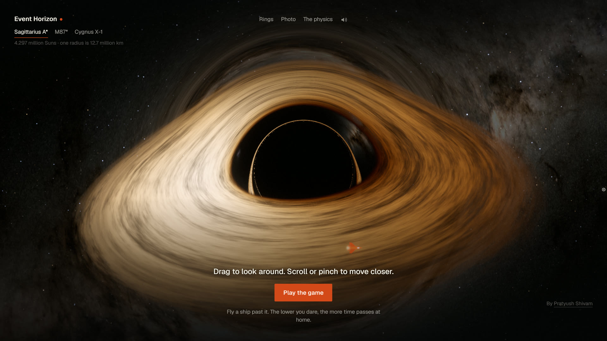</a>

<p align="center"><sub>Where the page opens. Left alone, the view turns slowly on its own.</sub></p>

## Photographs

Photo mode stops time, hides the interface and frees the camera. Drag to look, scroll to move, shift-drag to slide the frame, and three sliders set the lens, the heat of the disk and the exposure. Save renders the frame again at 3840 pixels wide, twelve rays per pixel, in about a second.

<table>
<tr>
<td width="50%" valign="top">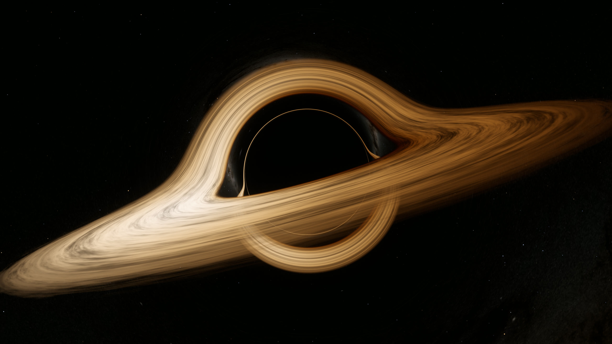</td>
<td width="50%" valign="top">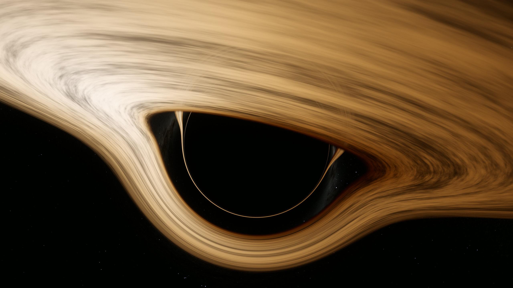</td>
</tr>
<tr>
<td width="50%" valign="top">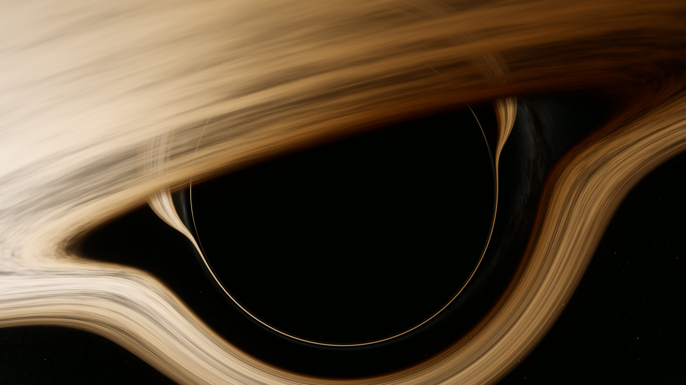</td>
<td width="50%" valign="top">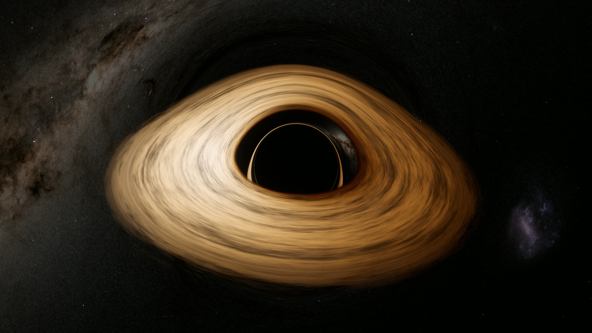</td>
</tr>
<tr>
<td width="50%" valign="top">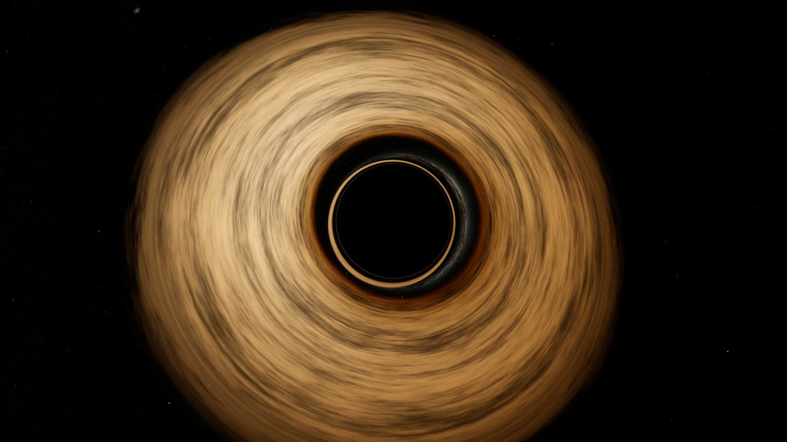</td>
<td width="50%" valign="top">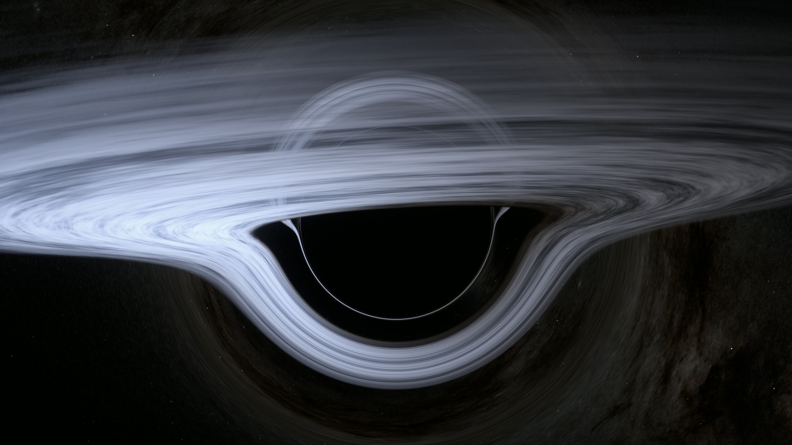</td>
</tr>
</table>

<p align="center"><sub>Six stills saved with the page's own Save photo button, scaled down here to 2560 pixels. The last has the disk's heat turned up to 11,000 K. The banner at the top is a seventh.</sub></p>

## On a phone

<table>
<tr>
<td width="33%" valign="top">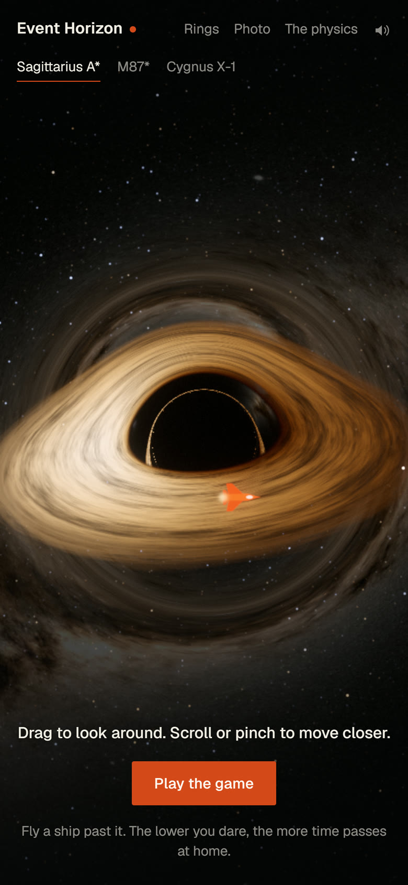</td>
<td width="33%" valign="top">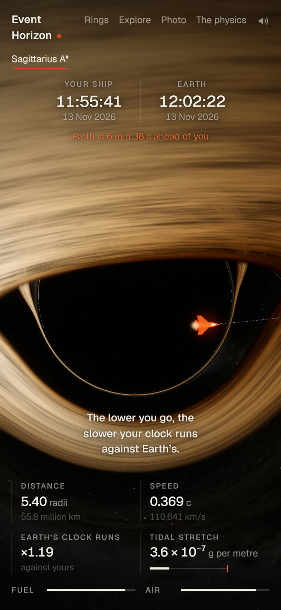</td>
<td width="33%" valign="top">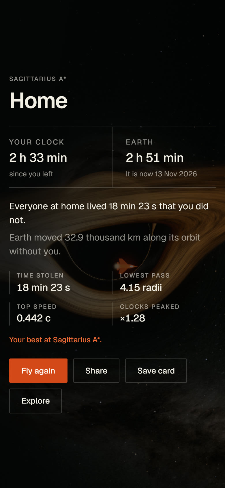</td>
</tr>
</table>

<p align="center"><sub>Drag left and hold to fall, right to climb. Captured at phone size in desktop Chrome, from a run in play.</sub></p>

## The physics

Everything is measured in the hole's own units: lengths in Schwarzschild radii, r<sub>s</sub> = 2GM/c², and times in r<sub>s</sub>/c. One simulation then serves every black hole; only the conversion to kilometres and seconds changes.

**Light.** Every light path lies in a plane through the hole. In that plane, with u = r<sub>s</sub>/r and φ the angle swept round the hole, the null geodesic equation of the Schwarzschild metric reduces exactly to

```
d²u/dφ² = −u + (3/2) u²
```

The fragment shader integrates this for each pixel with fourth-order Runge–Kutta in steps of 0.11 to 0.2 radians, at most 100 steps. Stepping in angle rather than distance is what makes it fast enough to run live: a ray that barely bends costs about thirty steps however far it travels, and its direction at infinity comes out exactly, with no "far enough" cut-off. A ray ends one of three ways. It reaches u = 1 and is captured: the shadow. It reaches u = 0 and escapes: the pixel shows the sky in that direction. Or it crosses the disk on the way, at angles known in advance, and the pixel shows the gas there. Rays that circle near the photon sphere before leaving cross the disk two or three times and draw the thin rings.

The camera is an observer hovering at its radius, so a ray leaving at angle ψ from the outward direction starts with du/dφ = −u √(1 − u) cot ψ and has impact parameter b = sin ψ / (u √(1 − u)).

**The disk.** A thin, opaque disk of gas on circular orbits, ending at the innermost stable circular orbit, 3 r<sub>s</sub>. The energy each ring radiates is the relativistic thin-disk result of Page & Thorne (1974), which for a non-spinning hole has a closed form (x = √(2r/r<sub>s</sub>), x₀ = √6):

```
F(r) ∝ [ x − x₀ + (√3/2) ln( (x+√3)(x₀−√3) / ((x−√3)(x₀+√3)) ) ] / ( x⁵ (x² − 3) )
```

It is zero at the inner edge, peaks at 4.78 r<sub>s</sub> and falls as r⁻³ far out. Each ring glows as a blackbody at T ∝ F<sup>¼</sup>. The light is then shifted on its way to the camera by gravity and by the gas's orbital motion together:

```
g = √(1 − 3r_s/2r) / (1 − Ω ℓ) × 1/√(1 − r_s/r_cam),   Ω = √(GM/r³)
```

where ℓ is the photon's angular momentum about the disk's axis per unit energy. A blackbody seen through a shift g is a blackbody at gT, and its total brightness scales as g⁴, so the side of the disk turning towards you is brighter and bluer. The colour of each temperature comes from Planck's law integrated against the CIE 1931 colour matching functions. The streaks in the gas are noise, but carried round at the true orbital rate of their own radius, so the inner disk laps the outer.

**The sky.** The glow of the Milky Way is NASA's Deep Star Maps 2020. The 41,486 stars to magnitude 8 are from the HYG catalogue, each drawn at its catalogued position, brightness and colour. A star is found for a pixel by turning the ray's exit direction into a cell of a cube map; its offset from the pixel is carried back to the screen through the local Jacobian of the lens map, so stars stay round points however the sky is stretched, and brighten where the hole magnifies them.

**The ship.** A timelike geodesic plus thrust, in the orbital plane, per unit of ship time τ:

```
d²r/dτ² = −GM/r² + (r − 3GM/c²) (dφ/dτ)² + aʳ
d²φ/dτ² = −(2/r) (dr/dτ)(dφ/dτ) + aᵠ
```

Newton has r where this has r − 3GM/c². That one term makes orbits precess, makes circular orbits unstable below 3 r<sub>s</sub>, and below 1.5 r<sub>s</sub> turns orbital speed against you. The engine's four-acceleration a is kept perpendicular to the four-velocity, so the pilot feels exactly the acceleration asked for. Integrated with fourth-order Runge–Kutta at a small fraction of the local orbital time.

**The clocks.** Earth's time against the ship's, gravity and speed together, added up along the path actually flown:

```
dt/dτ = √( (1 + (dr/dτ)²/f + r²(dφ/dτ)²) / f ),   f = 1 − r_s/r
```

On a circular orbit this is 1/√(1 − 3r<sub>s</sub>/2r): 1.07 at the station, √2 at the innermost stable orbit, without limit at the photon sphere.

**Tides.** Stretch per metre of length is 2GM/r³. At the horizon that is c⁶/(4G²M²), so the bigger the hole, the gentler its edge.

### What the tests check

45 tests, against results known in advance:

| | |
| :-- | :-- |
| Photon sphere | A ray launched sideways at exactly 1.5 r<sub>s</sub> circles; a hair outside escapes, a hair inside falls |
| Shadow | Rays are captured below b = 3√3 GM/c² and escape above it; the shadow's angular size matches sin θ = (b<sub>crit</sub>/r)√(1 − r<sub>s</sub>/r) from 2 to 40 r<sub>s</sub> |
| Light bending | Weak-field deflection is 4GM/(bc²) to 2%; the shader's integrator matches an independent Cartesian integrator from b = 2.7 to 30 r<sub>s</sub> |
| Shader steps | The coarsest step the shader uses lands rays within 0.002 radians of a step ten times finer |
| Far side of the disk | A ray passing over the hole from 10° above the disk meets the disk behind it |
| Innermost stable orbit | Orbital energy is least at 3 r<sub>s</sub>, speed there is c/2, and a nudge inward below it becomes a plunge |
| Circular orbits | Stay circular for 50 orbits to a part in 100,000, with energy and angular momentum held to a part in 100 million |
| Period | 2π√(r³/GM) in far-away time |
| Time dilation | 1/√(1 − 3r<sub>s</sub>/2r) on circular orbits; a hovering ship reads 1/√(1 − r<sub>s</sub>/r) |
| Precession | A bound orbit advances by 6πGM/(c²p) per turn in the weak field |
| Fall time | From the horizon to the centre in (2/3) r<sub>s</sub>/c for a fall from rest far away |
| Disk | The closed-form flux matches the Page–Thorne integral done numerically; redshift matches the Doppler factor times gravity edge-on |
| Colour | Blackbodies at 2856 K and 6500 K land on their CIE chromaticities |
| Tides | Scale as 1/M² at the horizon; Cygnus X-1 breaks the hull outside it, the giants never do |
| Shadow sizes | Computed from mass and distance, inside the Event Horizon Telescope's measured ranges for both holes |
| Any flying | Two hundred runs of random controls all end cleanly |

`src/engine/light.ts` holds the shader's integrator again in TypeScript, step for step, which is what lets the tests reach it.

### Sources

Every constant and every figure below was looked up for this page and is cited where it is used in the code.

| What | Value used | From |
| :-- | :-- | :-- |
| Speed of light | 299,792,458 m/s | Exact, by definition of the metre (SI) |
| Gravitational constant | 6.67430 × 10⁻¹¹ m³ kg⁻¹ s⁻² | [CODATA 2022, NIST](https://physics.nist.gov/cgi-bin/cuu/Value?bg) |
| Sun's GM | 1.3271244 × 10²⁰ m³ s⁻² | [IAU 2015 Resolution B3](https://arxiv.org/abs/1510.07674). Sizes are computed from this product, which is known far better than G |
| Sagittarius A* | 4.297 million Suns (±0.25%), 8,277 pc | [GRAVITY Collaboration 2022, A&A 657, L12](https://doi.org/10.1051/0004-6361/202142465) |
| Sagittarius A* ring | 51.8 ± 2.3 μas | [EHT Collaboration 2022, ApJL 930, L12](https://doi.org/10.3847/2041-8213/ac6674) |
| M87* | 6.5 ± 0.2 (stat) ± 0.7 (sys) billion Suns, 16.8 Mpc, ring 42 ± 3 μas | [EHT Collaboration 2019, ApJL 875, L6](https://doi.org/10.3847/2041-8213/ab1141) |
| Cygnus X-1 | 21.2 ± 2.2 Suns, 2.22 kpc | [Miller-Jones et al. 2021, Science 371, 1046](https://doi.org/10.1126/science.abb3363) |
| Disk flux | Thin-disk formula | [Page & Thorne 1974, ApJ 191, 499](https://ui.adsabs.harvard.edu/abs/1974ApJ...191..499P) |
| Milky Way | All-sky map, 4096 × 2048 | [NASA/Goddard Space Flight Center Scientific Visualization Studio, Deep Star Maps 2020](https://svs.gsfc.nasa.gov/4851). Gaia DR2: ESA/Gaia/DPAC |
| Stars | 41,486 to magnitude 8 | [HYG database v4.4](https://codeberg.org/astronexus/hyg), David Nash, CC BY-SA 4.0 |
| Star colour | B−V to temperature | [Ballesteros 2012, EPL 97, 34008](https://arxiv.org/abs/1201.1809) |
| Colour of heat | CIE 1931 fit | [Wyman, Sloan & Shirley 2013, JCGT 2(2)](https://jcgt.org/published/0002/02/01/) |
| Full moon to full moon | 29.53 days | [NASA Moon Fact Sheet](https://nssdc.gsfc.nasa.gov/planetary/factsheet/moonfact.html) |

What these give, computed by the page:

| | Sagittarius A* | M87* | Cygnus X-1 |
| :-- | :-- | :-- | :-- |
| One radius | 12.7 million km | 19.2 billion km | 62.6 km |
| Light crosses it in | 42 s | 17 h 47 min | 209 μs |
| Shadow from Earth | 53.3 μas | 39.7 μas | far too small to see |
| Stretch at the horizon, g per metre | 5.7 × 10⁻⁵ | 2.5 × 10⁻¹¹ | 2.3 million |
| One second of play is | 3.5 minutes | 3.7 days | 1 millisecond |

## Checked against NASA and the Event Horizon Telescope

**NASA Goddard's visualisation** ([svs.gsfc.nasa.gov/13326](https://svs.gsfc.nasa.gov/13326), Jeremy Schnittman, 2019) models the same thing: a non-spinning hole with a thin disk, seen nearly edge-on. The features it describes all appear here, in the same places, from the same physics: the shadow about twice the width of the horizon; the photon ring at its edge, made of light that went round the hole; the far side of the disk arched over the top; the underside of the disk as a ring below; and the left side of the disk brighter because that gas is coming towards the camera. Compare it with the first photograph above.

**The Event Horizon Telescope** measured ring diameters of 51.8 ± 2.3 μas for Sagittarius A* and 42 ± 3 μas for M87*. From the published masses and distances alone, this page's shadow comes out at 53.3 and 39.7 μas. Both are inside the measured ranges, and a test holds them there.

Where it differs, on purpose:

- NASA's picture and the telescope's images are of light no eye sees (X-rays, radio). This page puts the same physics in visible colours by setting the hottest ring to 3,900 K.
- The telescope's images are blurred to the resolution of an Earth-sized dish. These are not.
- Sagittarius A* and M87* really have thick, faint, hot flows, not a thin bright disk, and M87* has a jet. The thin disk is the textbook case, and the one NASA's visualisation uses.

## How it works

```
src/engine   the physics, with no page and no graphics: constants, the three holes,
             orbits and thrust, light paths, disk flux, blackbody colour, the star
             grid, the rules of a run, the words on the end card. Tested.
src/render   WebGL2 from scratch: the ray-tracing shader, the ship, bloom,
             tone curve and grain, and the high-resolution photograph
src/ui       sound, the end card and its image, the physics panel, storage
src/main.ts  the page: camera, input, instruments, the loop, adaptive resolution
tests        45 tests over the engine
scripts      build-sky.mjs, which makes the two sky files from their sources;
             banner.html, which sets the banner's words over a saved photograph
```

**One pass per pixel.** The scene is traced into a half-float buffer in linear light. The ship and station are added there, at the place their light actually arrives from: a small solver finds the bent path from each to the camera, so the ship passes correctly behind the hole. The predicted path and the named rings are drawn inside the tracing shader, in the plane of the orbit, so they bend with everything else.

**Light, then film.** Bright parts are spread by a six-level bloom, then exposure, a filmic curve that keeps colour, a little grain and a dither to hide banding in the dark. Exposure falls as the camera goes deeper, where everything outside is blueshifted and brighter.

**It finds its own resolution.** The page counts late frames in half-second windows and changes the tracing resolution to suit, from a third of the screen up to one and a half times it, and steps down through three levels of ray accuracy if it must. Without float render targets it falls back to an 8-bit path without bloom; without WebGL2 it says so plainly.

Measured in desktop Chrome on one laptop, flying a dive:

| Graphics | Window | Result |
| :-- | :-- | :-- |
| Nvidia RTX 4060 (laptop) | 1440 × 810 | 60 frames a second, traced at 1.5 × the window's resolution |
| Intel UHD (integrated) | 1440 × 810 | 60 frames a second, traced at 1.5 × |
| Intel UHD (integrated) | 1920 × 1080 | 60 frames a second, traced at 1.1 × |
| Nvidia RTX 4060 (laptop) | 4K photograph, 12 rays a pixel | under a second |

## What is simplified

- **The holes do not spin.** Real ones do. Spin flattens one side of the shadow, drags space round with it and moves the inner edge of the disk. That is the Kerr metric, and it is not here.
- **The disk is a thin opaque sheet** with no thickness, and no light bouncing off it.
- **The colours are chosen.** The physics of colour is right (blackbody, shifted by g, brightness by g⁴) but the temperature scale is set for eyes.
- **The camera hovers.** It does not share the ship's speed, so the view is not squeezed forwards and brightened by the ship's own motion. Nothing can hover inside the horizon, so moving the camera in there simply shows black. The ending of a run tells you what you would see instead of showing it.
- **The hole stands still.** Real black holes move, as everything does, but there is no drifting past the stars to see: see the note below.
- **The sky is Earth's sky**, placed around each hole, with the even haze of unresolved stars taken off so that empty sky is black.
- **The engine is absurd.** It gives 0.003 c²/r<sub>s</sub> at every hole so the flight feels the same. Around M87* that is 1.4 g. Around Sagittarius A* it is about 2,200 g, and around Cygnus X-1 far more. The ship is also drawn thousands of kilometres long.
- **The tidal gauge** uses the stretch on a body falling straight in, and the hull's limit of 10,000 g per metre is a choice.
- **Time is sped up or slowed** to five r<sub>s</sub>/c per second of play: about 210 times faster than life at Sagittarius A*, a thousand times slower at Cygnus X-1.

### Does the black hole move?

Yes. Sagittarius A* is carried round with the whole galaxy, and the galaxy itself moves at several hundred kilometres a second against the background of the universe. But motion only shows against something nearby, and the nearest stars are light years away. At 600 km/s it would take about 500 years to cross a single light year, so from beside the hole the sky would not visibly drift in a lifetime. What you would see moving is what the page shows: the disk turning, the ship and station orbiting, and the sky sliding as you yourself go round.

## Run it

Needs Node.js 20 or newer.

```bash
npm install
```

```bash
npm run dev
```

Then open `http://localhost:5250`.

| Command | What it does |
| :-- | :-- |
| `npm run dev` | Development server |
| `npm run build` | Type check, then a static build in `dist/`, ready for any static host |
| `npm test` | The tests for the physics |
| `npm run preview` | Serve the built page on port 5251 |

The build uses relative paths, so the same `dist/` works at a domain root or in a sub-folder. It makes no network calls beyond its own files. The only things kept in your browser are your best runs, the mute setting, the hole you last chose and whether you have seen the first lesson.

Every picture and recording on this page was captured from the running page in Chrome, on the laptop's own graphics card. The photographs were saved with the page's Save photo button.

## Licence

Code: [MIT](LICENSE). The typeface is [Geist](https://github.com/vercel/geist-font), under the SIL Open Font License.

`public/sky/stars.bin` is derived from the [HYG database](https://codeberg.org/astronexus/hyg) and so is under [CC BY-SA 4.0](https://creativecommons.org/licenses/by-sa/4.0/). `public/sky/milkyway.jpg` is NASA imagery, used with credit: NASA/Goddard Space Flight Center Scientific Visualization Studio; Gaia DR2: ESA/Gaia/DPAC. NASA does not endorse this page.

<p align="center"><sub>Built by <a href="https://www.pratyushshivam.com/">Pratyush Shivam</a>.</sub></p>
